# Kitap okuma ekranı: 3 tasarım önerisi (2026-10-17)

Barış: "senaryo okey de. kitap ne boktan uyumsuz vasat olmuş. biraz tasarım yapın elit dursun."

Örnek alınanlar: Julia Donaldson / Axel Scheffler kitapları (çizim çerçevesiz, yazı çizimin altında ya da karşı sayfada,
sıcak tırnaklı yazı), Oliver Jeffers (bol nefes, sade tipografi), Peppa ve Bluey kitapları (konuşan karakter renkli),
Apple Books resimli kitapları, Epic! ve Vooks (okunan kelime vurgusu).

Bütün ekran görüntüleri gerçek tarayıcıda, aynı sayfayla (2. sayfa "Kahvaltı"), DPR 3. Dosyalar `ekip/kitap/ekran/`.

## Eski hâl: neden ucuz duruyordu

| | |
|---|---|
| 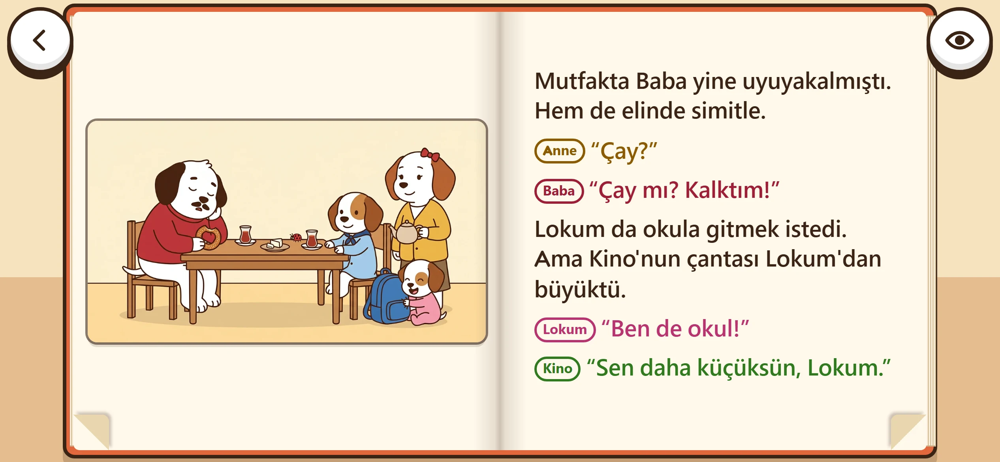 | 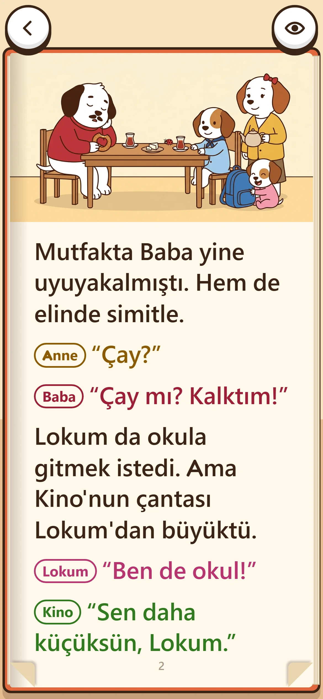 |

- Sol sayfada küçük, çerçeveli 16:9 resim; üstü altı bomboş krem. Resim sayfayla konuşmuyor, "yapıştırılmış" duruyor.
- Kalın turuncu çerçeve + kalın konturlu üçgen köşeler: oyun arayüzü gibi, kitap gibi değil.
- Yazı uygulama yazısı (Fredoka); konuşanlar hap biçimli ad etiketiyle; sarı kutu vurgu.
- Ayrıca bir hata: ortak stil (`.mk-kok button`) raftaki kapakların ve sırtların rengini siliyordu (raf beyaz/boş görünüyordu).

## Netlik hesabı (src/ui/netlik.ts: ekrandaki en × 3 ≤ resmin piksel eni)

- Eski çizimler 1376×768 → en çok **458×256 CSS px**.
- Yeni çizimler: Recraft crisp_upscale 4096×2286 → `kitap-isle.cjs` ile **2752×1536** webp (q92, 140-400 KB) → en çok
  **917×512 CSS px**. Oran aynı (1.79), uğur böceği ve dokunma yerleri değişmedi.

| Ekran | A: yayılan resim | B: sol sayfa tam resim | C: resim kenardan kenara (seçilen) |
|---|---|---|---|
| 844×390 | 557×312 → **1671 px** | 400×266 (kırpma %16) → 1200 px | 400×223 → **1200 px** |
| 932×430 | ~620×346 → 1860 px | 444×286 → 1332 px | 444×248 → 1332 px |
| 667×375 | ~520×291 → 1560 px | 311×207 → 933 px | 311×173 → 933 px |
| 390×844 | 362×202 → 1086 px | 362×202 → 1086 px | 362×202 → 1086 px |
| iPad 1024×768 | ~960 → 2880 px | 490 → 1470 px | 490×273 → 1470 px |
| iPad 768×1024 | 706 → 2118 px | 706 → 2118 px | 706×394 → 2118 px |

- **A** 1376 ile net değil (kitap 458×256'ya küçülürdü); 2752 ile telefonda net.
- **B** ve **C** telefonda 1376 ile de net. Tablette kenardan kenara için 2K gerekir (1470-2118 px).
- **Sonuç: 2K resim telefonda gerekmiyordu, tablette gerekiyordu. Artık geldi (2752): her ekranda kenardan kenara.**
  Tek istisna iPad Pro 12.9 dikey (sayfa 963 px): resim 917 px'te durur, sayfanın üstünde 23 px eşit payla ortalanır.

## Öneri A: Resim iki sayfaya yayılır, metin bulut/bantta

| | |
|---|---|
| 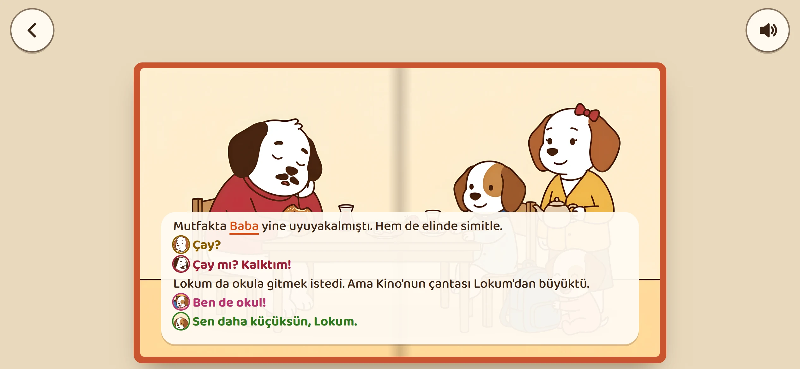 | 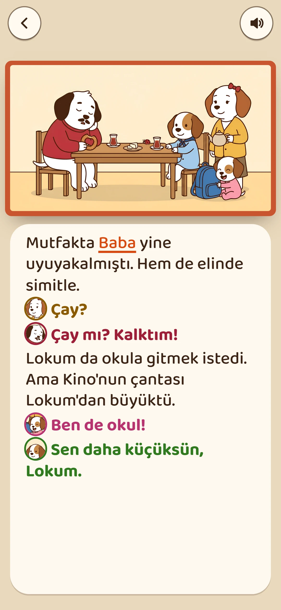 |

- Resim açık kitabın tamamında, oluğun iki yanına yayılır; metin altta yuvarlak köşeli krem bantta (Baloo 2).
- Konuşan: küçük yüz + renk; vurgu: turuncu alt çizgi.
- **Sorun:** Sayfa metinleri 160-250 harf, 3-7 satır. Bant resmin **%40-45'ini kapatıyor** (2. sayfada masa, Lokum ve
  çanta görünmüyor), yazı 13-15 px'e iniyor. 16:9 çizim 2.16 oranlı telefon ekranını zaten dolduramıyor (yanlarda boşluk).
  Çizimler metin için boş alan bırakılarak çizilmedi. Kısa metinli bir kitapta (bebek kitabı) güzel olur; bu kitapta değil.
- Netlik: 1376 ile olmaz, 2752 ile olur.

## Öneri B: Klasik kitap: sol sayfa tam resim, sağ sayfa yazı

| | |
|---|---|
| 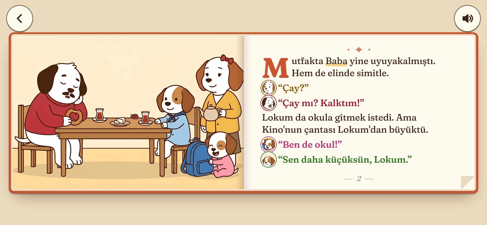 | 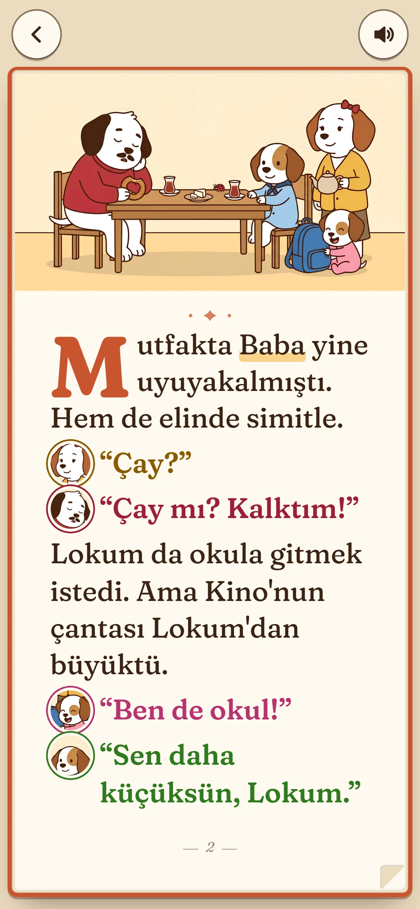 |

- Sol sayfanın tamamı resim (çerçevesiz, kenarlardan %13-16 kırpılır); sağda Fraunces yazı, süslü baş harf, küçük süs,
  "— 2 —" sayfa numarası, konuşanın yüzü.
- **Sorun:** Resim sayfayı kırpmadan kaplasın diye sayfa yatık olmalı (en/boy ≥ 1.5) → kitap basık (844×390'da 800×266)
  ve yazı sayfası küçük: yazı **844×390'da 14-16 px, 667×375'te 12 px**. Bu, çözünürlükten değil çizimin 16:9 oranından;
  2752 resim de bunu çözmüyor. Dikeyde güzel (C ile aynı).

## Öneri C (seçilen ve uygulanan): Resim kenardan kenara, yazı resmin altından akar

| Yatay 844×390 | Dikey 390×844 |
|---|---|
| 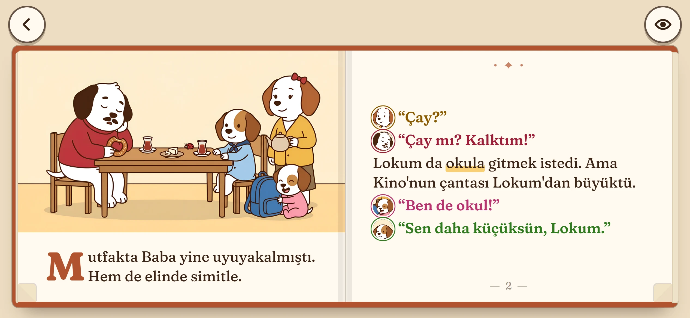 | 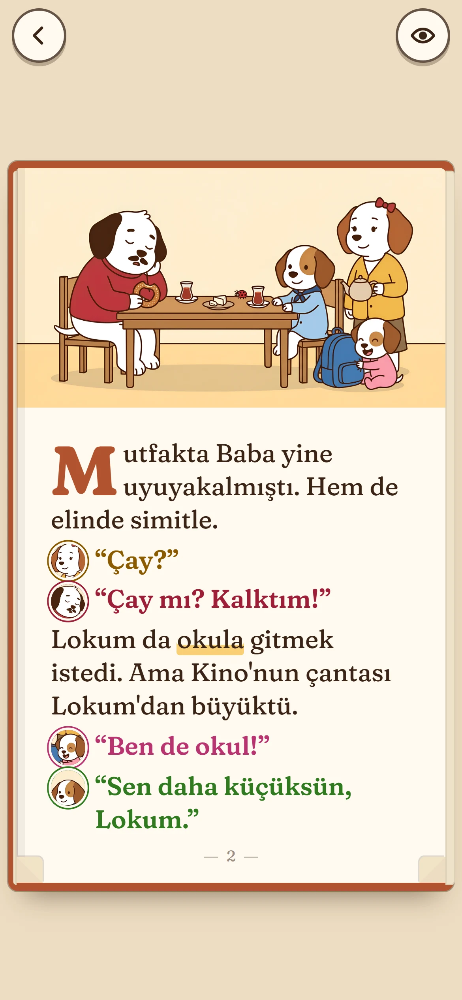 |

Basılı resimli kitaplardaki "resim üstte, yazı altında ve karşı sayfada" düzeni:

- **Resim:** sol sayfanın üstünde kenardan kenara, çerçevesiz, kırpılmaz (16:9 olduğu gibi). Yazı resmin hemen altından
  başlar (ilk satır, süslü baş harfle), kalanı sağ sayfada sürer. Sol sayfada boş krem kalmaz. Bölmeyi kod yapar: sol
  parçaya sığan satırlar orada, kalanı sağda; iki tarafta aynı boy. Dikeyde tek sayfa: üstte resim, altta bütün yazı.
- **Yazı tipi:** Fraunces (Google Fonts, SIL OFL), yumuşak ("SOFT 100") sürümü: sıcak, tırnaklı, basılı kitap hissi,
  Türkçe harfler tam. `kitap/yazi/` içinde paketli (2 woff2, 226 KB), internet istemez. Kitap yazı yüklenince kurulur.
- **Boy ve satır aralığı:** sayfaya sığan en büyük boy; satır aralığı 1.3, satırlar arası 0.26 em.
  Ölçülen: 844×390'da **18-21 px**, 667×375'te **17-22 px**, 390×844'te **20-25 px**, tablette 28-33 px.
- **Süslü baş harf:** sayfanın ilk anlatı satırında, kitabın koyu renginde, ~2.7 satır boyunda.
- **Konuşma satırları:** solda konuşanın küçük yüzü (madalyon; kitabın kendi çiziminden yuvarlak kırpılmış, 144 px,
  `ekip/kitap/kitap-yuz.cjs`), söz karakterin renginde, tırnak içinde. Yüzü olmayan (ikinci kitabın çizimleri gelmedi,
  Dede, Çocuklar) adının baş harfiyle aynı boyda renkli daire. İkinci kitap aynı karakterlerin yüzünü ilk kitaptan alır.
- **Kelime vurgusu:** sarı kutu yerine okunan kelimenin altı yumuşak sarı kalemle çizilir (yarım yükseklikte).
- **Kâğıt:** düz, sıcak beyaz (#FFFAF1); doku ve gradyan yok. Oluk: ince düz şeritler ve tek ince çizgi.
- **Kitap kenarı ve sırtı:** kitabın renginin koyu tonunda ince cilt (eski kalın turuncu çerçeve yerine), sayfa
  bloğu düz kâğıt renginde, okundukça kalınlığı değişir. Köşelerde küçük kıvrık kâğıt (dokununca çevirir).
- **Düğmeler:** küçük, krem, ince konturlu (46 px), kitabın üstünde ayrı şeritte; kitabın üstüne binmez.
  Sayfa numarası altta ortada "— 2 —"; sağ sayfanın üstünde küçük süs.
- **Kapak, raf, 3D kitap aynı dille:** kapakta çizim kenardan kenara, altında kitabın renginde Fraunces başlık ve
  kapak sözü (dikeyde başlık üstte, çizim ortada, altta söz ve "MİNO İLE KİNO" seri adı). Raftaki kapaklar açık
  kitabın oranında (yatayda yatık resimli kitap, dikeyde dik). Sırtlar: Fraunces ad, cilt bezinin ince bantları, uzun
  ad sırta sığacak kadar küçülür. Raf düz renkli ahşap.

| Raf | Kitap öne gelir (3D) |
|---|---|
| 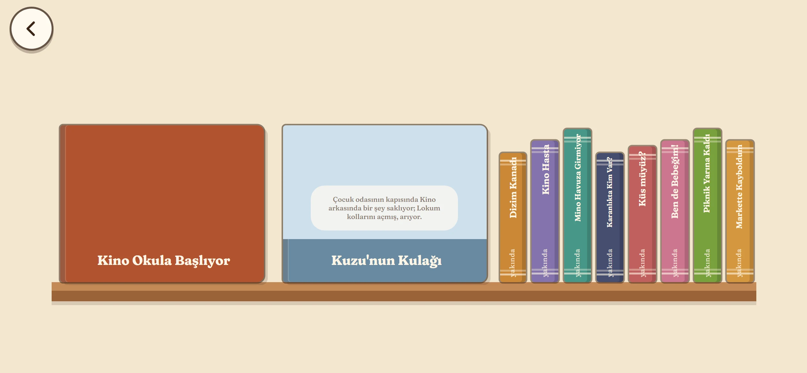 | 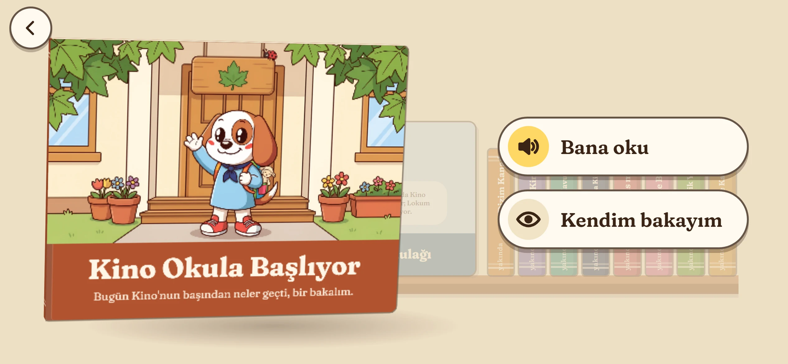 |
| 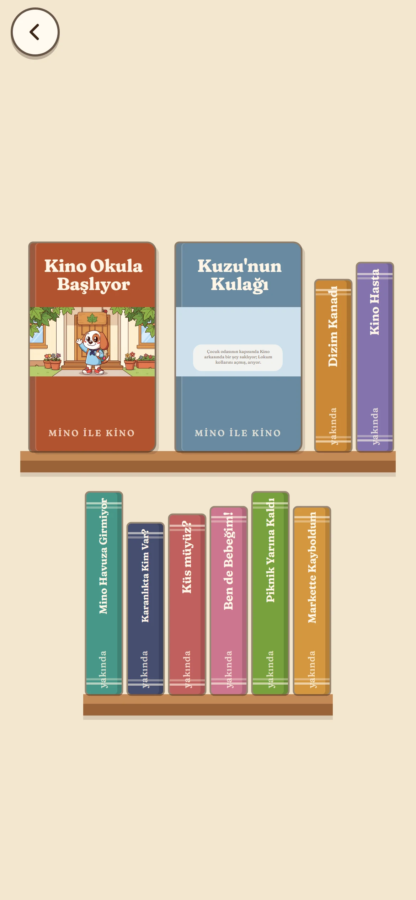 | 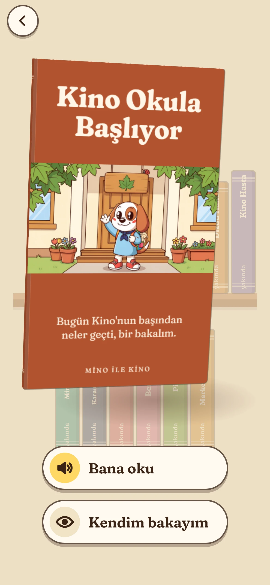 |

| En uzun sayfa, en küçük telefon (667×375) | Sayfa kıvrılıyor | Son sayfa |
|---|---|---|
| 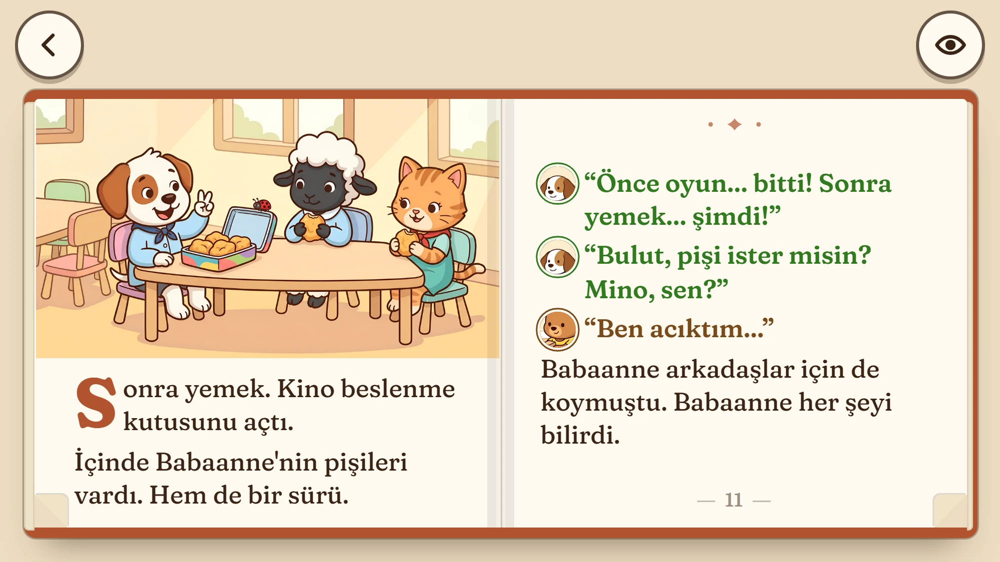 | 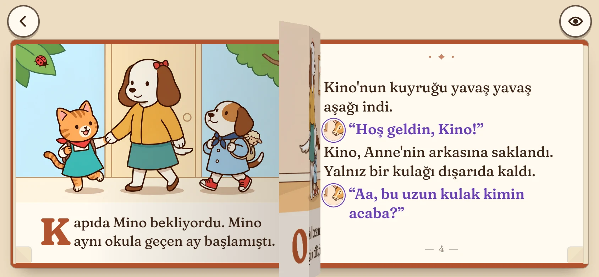 | 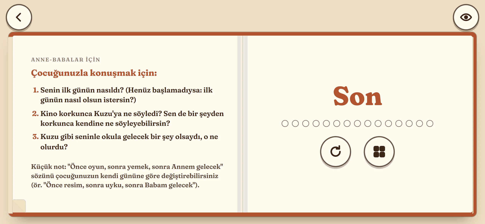 |

| Tablet yatay | Tablet dikey |
|---|---|
| 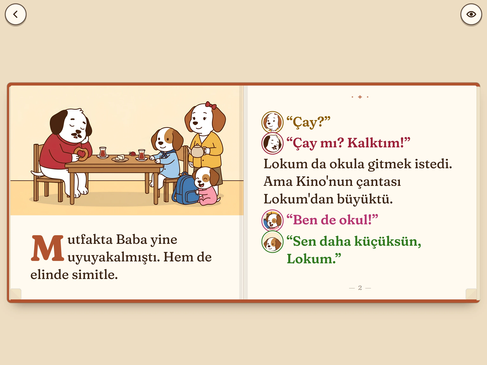 | 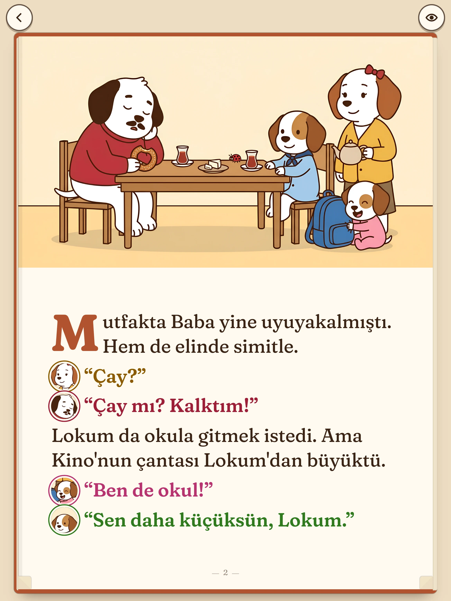 |

**Neden C:** Üçü arasında çizimi hiç kapatmayan, kırpmayan ve yazıyı en büyük tutan tek düzen. A çizimin yarısını
yazıyla örtüyor, B yazıyı 12-16 px'e düşürüyor. C'de çizim telefonda sayfa eninde, yazı 18-25 px; yeni 2752 çizimlerle
tablette de kenardan kenara.

## Çalışmaya devam eden

Sesli okuma (satır satır, kelime vurgusu, satıra dokununca okuma), parmakla ve köşeden sayfa çevirme (kıvrılan yaprak),
canlanan anlar (dokunma bölgeleri, parıltı), uğur böceği, ipucu, kayıt, ikinci kitap ("Kuzu'nun Kulağı", yer tutucu
resimlerle) değişmedi. Testler: `tests/unit/kitap.test.ts` (13), `tests/e2e/kitap.spec.ts` (7).

## Dosyalar

- `kitap/src/yerlesim.ts` (ölçüler), `metin.ts` (bölünen metin, yüz madalyonu, baş harf), `kitap.ts` (yüzler, kapak,
  raf), `kitap.css` (bütün görünüm), `main.ts` (yazı yüklenince kur), `kitap/yazi/` (Fraunces + lisans).
- `ekip/illustrator/kitap-isle.cjs`: önce `recraft-up/` (netleştirilmiş) kaynakları kullanır, uzun kenar 2752.
  Düzeltilen 4, 5, 7. sayfalar gelince aynı yolla: `recraft-up/sayfa-04.webp` … konup betik yeniden çalıştırılır.
- `ekip/kitap/kitap-yuz.cjs`: konuşan yüzleri (yeni çizim gelince yeniden çalıştırılır; ölçüler kaynak enine göre).
- Öneri A ve B'nin deneme sayfası koda girmedi (yalnız bu belgedeki görüntüler).
