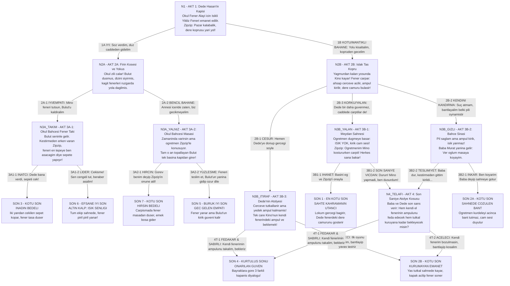

# 🎬 KİNO’YLA SEN SEÇ — BÖLÜM 3: "ALTIN YILDIZ VE BÜYÜK SINAV" (V2 — ELİT SÜRÜM)
*(Detroit: Become Human — Kids Edition | Sıfır Mantık Hatası, Sıfır Boş Konuşma, Gerçek Çocuk Psikolojisi ve Kesintisiz Neden-Sonuç Akışı)*

---

## 🧠 V2 İYİLEŞTİRME İLKELERİ (NE DEĞİŞTİ?)

Bu sürümde tüm yapay kurgular, çizgi film saçmalıkları ve boş replikler temizlendi:
1. **Gerçekçi Emanet:** Cam müzik kutusu / kurma anahtarı / misket sıkıştırma gibi uydurma düzenekler kaldırıldı. Emanet, Dede Hasan’ın okul Fener Alayı için ahşap çerçevesini ve pil/ampul tesisatını yeni hazırladığı **Işıklı Yıldız Feneri**dir. Ceren Öğretmen üç sokak ötedeki okulda hazırlık yapmaktadır; sorumluluk duygusu kazansın diye feneri Dede Hasan’dan okula götürme görevini Kino alır.
2. **Her Seçimin Kendi İçinde Mantığı Var:** Kötü seçimler "kötü olmak için" seçilen saçma düğmeler değil; bir çocuğun o an gerçekten *"Haklısın, böyle yaparsam daha iyi olur"* diye kanacağı mantıklı gerekçelerle kuruludur:
   - *Kestirme yolu:* "Oyun oynamak" için değil, **"Pazar yokuşu kalabalık ve uzun; dere köprüsünden geçersek erkenden varırız!"** mantığıyla caziptir.
   - *Bulut’u geçmek:* "Pasta yemek" için değil, **"Bulut’un annesi zaten okulda, ama fener gecikirse tüm sınıf bizi bekleyecek!"** bahanesiyle rasyonelleştirilir.
   - *Bandı seçmek:* "Mino’ya suç atmam, belki sadece pili yerinden oynamıştır, sararsak yanar" diye kendini kandırma psikolojisine dayanır.
   - *Tutkalı beklememek:* "İlk oyunu kaçırmayayım, kendi fenerim de bozulmasın; dikkatli taşırsam yapışır" aceleciliğidir — ve fizik kuralları yüzünden elinde kalır.
3. **Işınlanan Karakter Yok:** Zıpzıp bir anda fırından kuleye ışınlanmaz. Kestirmeyi bildiği için okul bahçesine gerçekten daha erken varmış ve feneri kendi asmak için beklemektedir.
4. **Sıfır Boş Konuşma:** Anlatıcı sadece girişte ve finallerde konuşur; ekranda görülen şeyi cümleyle tekrar eden dolgu replikler tamamen çıkarılmıştır.

---

## 🗺️ DETROİT AKIŞ ŞEMASI (TAM DALLANMA)



---

## 🧠 DETROİT DURUM HAFIZASI (`State Flags`)

| Bayrak / Durum | Tetikleyen Karar | Ekranda Çıkan İkon | Hikâyedeki Somut Etkisi |
| :--- | :--- | :--- | :--- |
| `yol` | `1A` / `1B` | `☀️ Pazar Caddesi` / `🌿 Dere Köprüsü` | İkinci ve üçüncü aktı tamamen ayırır; geri dönüşsüz mekân farkı yaratır. |
| `bulutDost` | `2A-1` / `2A-2` | `🤝 [Ekip Büyüdü: Bulut]` / `💔 [Bulut Bırakıldı]` | `true` ise Bulut bahçede kavgayı engelleyen kilit desteği verir. `false` ise bahçeye topallayarak girip vicdan yüzleşmesi yaratır. |
| `lokumDurum` | `2A-2`, `2B-2/3` | `😟 [Lokum Tedirgin]` | Lokum’un duruşunu değiştirir ve `SON 1`’de korkusunu yenip gerçeği haykırmasını sağlar. |
| `sucOrtagi` | `2B-3` | `🕸️ [Büyük Yalan]` | Sahne açılışında Zıpzıp’ın suçu Mino’nun üstüne atmasını tetikler. |
| `erkenItiraf` | `2B-1` | `💎 [Cesur Dürüstlük]` | `SON 4` (Kurtuluş)’te en onurlu kapanış diyalogunu açar. |
| `minoGuven` | `1B`, `2B-3` | `💔 [Mino Kırıldı]` | `SON 4`’te Kino’nun sahneden inip Mino’dan diz çökerek özür dilemesini zorunlu kılar. |

---

## 🎨 MİNKİNO GÖRSEL & ANİMASYON STANDARTLARI

- **Çizgi & Renk:** Temiz düz 2D vektör renkler, tüm karakter ve objelerde **ince siyah dış kontür**; ampul, ahşap fener, yara bandı ve fener kâğıtlarında benek/gradyan doku yok (*Sandviç Testi* uyumlu).
- **Kanon Karakterler:** Kino (4–5 yaş, saat okumaz — zaman baskısı okul zili ve akşam güneşi kızıllığıyla verilir), Lokum (**beyaz tüylü**), Bulut (**kayısı tonunda**), Zıpzıp (**hızlı konuşan erkek tilki**), Baba Murat (**alın beni yok**), Mino, Dede Hasan, Ceren Öğretmen. El yıkama videosundaki iki insan çocuğu kadro dışıdır. "Çay mı?" şakası yoktur.
- **Kadraj & Hareket:** Karşıdan yürüyüş yok; tüm yürüme ve koşular **yandan profil** (sheet başına uzak planda 8–10, orta planda 4–6 poz). Her kesme **en az 2,5 saniye**. Her seçim kartı kendi kadrajında çizilir; seçimden sonra önce hareket oynar, ardından sonuç repliği duyulur.

---

## 📖 SAHNE SAHNE ELİT SENARYO VE DİYALOGLAR

---

### 🔵 `N1` — AKT 1: DEDE HASAN’IN BAHÇE KAPISI
- **Mekân:** Bahçe kapısı ve ikiye ayrılan sokak. Sağda hareketli, hafif yokuşlu **Pazar Caddesi**; solda söğütlerin altından okula inen gölgeli **Dere Köprüsü patikası**.
- **Aksiyon:** Dede Hasan ahşap saplı, içindeki küçük ampulü pırıl pırıl yanan **Işıklı Yıldız Feneri**ni sepete yerleştirir. Dışarı çıktıklarında **Mino** ve **Zıpzıp** köşede beklemektedir.
- **Replikler:**
  - **Dede Hasan:** `"Üç sokak ötedeki Ceren Öğretmen’e düz caddeden götür Kino. Lokum’un elini hiç bırakma."`
  - **Zıpzıp:** `"Pazar caddesi hem yokuş hem çok kalabalık, sepetle yarım saat sürer! Dere köprüsü yarı yol, okulun arka kapısına hemen çıkarız!"`
  - **Mino:** `"Dün yağmur yağdı Zıpzıp, köprü taşları kaygandır. Dede düz cadde dedi."`
  - **Kino:** *(iki yola bakarak)* `"Kalabalıkta gecikir miyiz, yoksa köprüden hemen geçer miyiz?"`
- **Seçim Sorusu (`D1`):** `"Kino hangi yoldan gitsin?"`
  - **Seçenek `1A` (✅ İYİ / SORUMLU):** `"Dede’ye söz verdim. Yavaş olsun ama düz caddeden gidelim."`
    - *Aksiyon:* Kino Lokum’un elini sıkıca tutar, Mino ile sağ caddeye döner. Zıpzıp *"Siz bilirsiniz, ben köprüden gidiyorum!"* deyip sola koşar. → **`N2A`**
  - **Seçenek `1B` (❌ KÖTÜ AMA MANTIKLI):** `"Yol yarı yarıya kısalıyor! Dikkatli yürürsek bir şey olmaz, köprüden gidelim!"`
    - *Aksiyon:* Mino *"Ben caddeden gidiyorum, sorumluluk sende Kino!"* deyip ayrılır. Kino, Lokum’u elinden tutup Zıpzıp’ın peşinden patikaya girer. → **`N2B`**

---

### 🌿 DAL A: PAZAR CADDESİ ROTASI

---

### 🟠 `N2A` — AKT 2A: FIRIN KÖŞESİ VE YOKUŞ
- **Mekân:** Pazar Caddesi’ndeki fırının önü. İleride okulun bahçe duvarı görünür.
- **Aksiyon:** Uzaktan okulun **hazırlık zili ("Zırrrr!")** çalar! Tam köşede **Bulut** ayağı kaldırım taşına takılıp düşmüştür; dizi sıyrılmıştır ve okul gösterisi için taşıdığı renkli kâğıt fenerler rüzgârla yola doğru yuvarlanmaktadır.
- **Replikler:**
  - **Bulut:** `"Dizim çok acıyor... Fenerlerim ezilecek, tek başıma yetişemiyorum!"`
  - **Lokum:** `"Abi... Bulut düştü..."`
  - **Mino:** `"Hazırlık zili çaldı Kino! Ama Bulut’u da böyle bırakamayız."`
- **Seçim Sorusu (`D2A`):** `"Kino zil çalmışken ne yapsın?"`
  - **Seçenek `2A-1` (✅ İYİ / EMPATİ):** `"Mino feneri koru! Önce Bulut’un fenerlerini toplayıp dizini saracağız."`
    - *Aksiyon:* Kino emaneti güvenle Mino’ya verir. Lokum’la rüzgâra kapılan kâğıt fenerleri yakalar, cebindeki temiz mendili/yara bandını Bulut’un dizine sarar. Bulut doğrulup Kino’nun koluna girer, dört arkadaş birlikte okula yürür.
    - *Geçiş Repliği (Bulut):* `"Sağ ol Kino... Sen olmasan hepsi ezilecekti. Artık birlikteyiz!"` → **`N3A_TAKIM`**
  - **Seçenek `2A-2` (❌ BENCİL BAHANE):** `"Bulut, annen zaten okulun içinde! Emanet fener gecikirse herkes bizi bekler, koşmamız lazım!"`
    - *Aksiyon:* Kino gözünü kaçırıp Lokum’un elini çekerek hızlanır. Lokum başını çevirip geride kalan Bulut’a bakar. Mino bir kâğıt feneri aceleyle sepete itip soğuk bir ifadeyle Kino’nun peşinden koşar.
    - *Geçiş Repliği (Mino):* `"Zorunda kaldığın için mi koştun, yoksa sadece ilk varmak için mi Kino?"` → **`N3A_YALNIZ`**

---

### 🔵 `N3A_TAKIM` — AKT 3A-1: OKUL BAHÇESİ FENER TAKI
- **Mekân:** Okul bahçesindeki süslü ahşap **Fener Takı** (yüksekte demir çengel). Ceren Öğretmen yan tarafta diğer sınıflarla ilgilenmektedir.
- **Aksiyon:** Kestirmeden çoktan okula varmış olan **Zıpzıp**, sıkıldığı için takın altındadır. Kino ekibini görünce övünerek koşar ve sepetin kulpundan tutar! İki çocuk sepeti çekiştirirken alttaki taş zeminin üzerinde fener tehlikeli şekilde sallanır.
- **Replikler:**
  - **Zıpzıp:** `"Gördün mü? Ben dakikalar önce geldim! Ver feneri, en yüksek çengele ben asacağım!"`
  - **Mino:** `"Bırakın! İkiniz çekerseniz sapı kopup taşa düşecek!"`
- **Seçim Sorusu (`D3A1`):** `"Zıpzıp sepeti çekerken Kino ne yapsın?"`
  - **Seçenek `3A1-1` (❌ ÖFKELİ İNAT):** `"Dede bana emanet etti! Bırak dedim!"` *(Tüm gücünle kendine çek!)*
    - *Aksiyon:* Kino hışımla sepeti çeker; Zıpzıp’ın patisi kayınca sepet savrulur ve **fener taş zemine "ŞANGIR!" diye çarpar!** → **`💀 SON 3: İNADIN BEDELİ`**
  - **Seçenek `3A1-2` (✅ AKILLI LİDERLİK):** `"Dur Zıpzıp! Sen uzun çengeli tut, Bulut’la ben sepeti kaldıralım, tepeye beraber asalım!"`
    - *Aksiyon:* Kino çekmeyi anında kesip sepeti yere doğru alçaltır. Bulut ve Mino yandan destek verir. Şaşıran Zıpzıp inadı bırakıp çengeli yakalar; birlikte feneri en yüksek noktaya takarlar! → **`🏆 SON 6: ALTIN KALP — BÜYÜK IŞIK ŞENLİĞİ`**

---

### 🔴 `N3A_YALNIZ` — AKT 3A-2: OKUL BAHÇESİ MASASI
- **Mekân:** Bahçe ortasındaki açılış masası ve okul giriş kapısı. *(Bulut yanında değildir; Ceren Öğretmen üç adım ötede velilerle konuşmaktadır.)*
- **Aksiyon:** Kino masaya koştuğunda kestirmeden erken gelen **Zıpzıp** masanın başında durur ve övgüyü almak için sepetin kulpuna uzanır. Tam o anda **dizini tuta tuta topallayan Bulut**, tek başına bahçe kapısından içeri girer; Lokum dönüp kapıyı gösterir.
- **Replikler:**
  - **Zıpzıp:** `"Öğretmen meşgul! Ben senden önce geldim, ver feneri masanın ortasına ben koyayım!"`
  - **Lokum:** *(kapıyı göstererek)* `"Abi... Bulut geldi. Tek başına..."`
- **Seçim Sorusu (`D3A2`):** `"Kino bu anda ne yapsın?"`
  - **Seçenek `3A2-1` (❌ HIRÇIN SAVUNMA):** `"Görev benimdi! Çekil Zıpzıp!"` *(Sepeti geri çekip öne atıl!)*
    - *Aksiyon:* Kino Zıpzıp’ın önüne sertçe geçerken dirsekleri çarpışır; sepet masanın kenarından kayıp taş zemine düşer ve ampul patlar! → **`💀 SON 7: HIRSIN BEDELİ`**
  - **Seçenek `3A2-2` (🔄 ALÇAKGÖNÜLLÜ YÜZLEŞME):** `Kavgayı bırakıp feneri masaya güvenli koy; ardından Bulut’un yanına gidip özür dile.`
    - *Aksiyon:* Kino inatlaşmaz, feneri masaya sağlamca yerleştirir. Sonra kalabalıktan sıyrılıp kenarda oturan Bulut’un yanına diz çöker. → **`🥈 SON 5: GEÇ GELEN EMPATİ`**

---

### 🌪️ DAL B: DERE KÖPRÜSÜ & KRİZ ROTASI

---

### 🟡 `N2B` — AKT 2B: ISLAK TAŞ KÖPRÜ ("KAZA VE ÜÇ MANTIKLI KAÇIŞ")
- **Mekân:** Dere üzerindeki yağmurdan ıslanmış yosunlu taş köprü.
- **Aksiyon:** Zıpzıp hızlı adımlarla önden geçer. Kino elinde sepetle köprü taşından atlarken **ayağı yosunda kayar!** Feneri göğsünde korumaya çalışsa da sert taşa çarpar: **üst ahşap kapak yerinden çıkar, küçük ampul kırılır, tabanına dere çamuru bulaşır!** Kino düğmeye basar ama ışık hiç yanmaz.
- **Replikler:**
  - **Lokum:** *(titrek sesle)* `"Abi... ışığı söndü..."`
  - **Zıpzıp:** *(panikle)* `"Eyvah! Hemen geri dönersek Dede bir daha sana hiçbir emanet vermez! Bak çantamda koli bandı var: Kapağı sıkıca saralım, belki sadece pili oynamıştır, masada yine yanar! Ya da sorarlarsa ‘caddede kalabalıkta biri çarptı’ deriz — zaten Mino orada tek koşuyordu!"`
- **Seçim Sorusu (`D2B`):** `"Kino bu kazadan sonra ne yapsın?"`
  - **Seçenek `2B-1` (✅ ZOR DÜRÜSTLÜK):** `"Yalan söylersem iş daha çok büyür. Geri dönüp Dede’ye gerçeği anlatacağım."`
    - *Aksiyon:* Kino kırık feneri kucaklayıp Lokum’un elini tutar, hemen Dede Hasan’ın atölyesine geri yürür. → **`N3B_ITIRAF`**
  - **Seçenek `2B-2` (⚠️ KENDİNİ KANDIRAN GİZLEME):** `"Kimseye suç atmam! Ama belki sadece pili gevşemiştir; bandı ver, kimse üzülmeden sarıp bakalım."`
    - *Aksiyon:* Kino bandı sıkıca sarıp kapağı kapatır, kırmızı kurdeleyi de üstüne geçirir; bahçeye kadar sırrı saklayarak yürür. → **`N3B_GIZLI`**
  - **Seçenek `2B-3` (💀 KORKUDAN DOĞAN BÜYÜK YALAN):** `"Dede bana bir daha hiç güvenmez... Sorarlarsa ‘caddede biri çarptı’ diyelim, sakın köprüden söz etme!"`
    - *Aksiyon:* Zıpzıp sırıtarak başını sallar: *"Ben de Mino’yu koşarken gördüm derim, tamamdır!"* Kino korkuyla sesini çıkarmaz, anlaşmayı kabul etmiş olur. Lokum şokla ağzını kapatır. → **`N3B_YALAN`**

---

### ⚠️ `N3B_GIZLI` — AKT 3B-2: BAHÇE SIRASI ("BABA’YLA KARŞILAŞMA")
- **Mekân:** Okul bahçesinin arka giriş sırası.
- **Aksiyon:** Kino sıraya oturup fenerin pilini çevirir ama ampul kırık olduğu için ışık **kesinlikle yanmaz**; üstelik bant kenardan açılmaya başlamıştır. Tam o an yardım için bahçeye gelen **Baba Murat** Kino’nun yanına yürür!
- **Replikler:**
  - **Baba Murat:** `"Zamanında yetişmişsin oğlum. Ver feneri, Ceren Öğretmen’in masasına ben bırakayım."`
  - **Lokum:** *(fısıldayarak)* `"Abi... yanmıyo..."`
- **Seçim Sorusu (`D3B2`):** `"Baba feneri isterken Kino ne yapsın?"`
  - **Seçenek `3B2-1` (❌ SONUNA KADAR İNKÂR):** `"Yok Baba, teşekkürler! Görevi bana verdiler, masaya kendim koyayım!"`
    - *Aksiyon:* Kino feneri koşarak masaya bırakır. Ceren Öğretmen kurdeleyi çözüp düğmeye bastığı anda **koli bandı açılır, üst kapak düşer ve kırık ampul parçaları masada şangırdar!** → **`💥 SON 2A: SAHNEDE ÇÖZÜLEN BANT`**
  - **Seçenek `3B2-2` (🔄 BABAYA TESLİMİYET):** `"Baba dur... Fener kırıldı. Söz dinlemedim, köprüden geçerken düştü..."`
    - *Aksiyon:* Baba Murat feneri açıp bakar, derin bir nefes alır: *"Hatanı saklaman beni üzdü ama şimdi durman doğru oldu. Koş, Dede’nin atölyesinde son bir şansımız var!"* → **`N4_TELAFİ`**

---

### 💀 `N3B_YALAN` — AKT 3B-1: MEYDAN SAHNESİ ("MAHKEME ANI")
- **Mekân:** Okul şenlik meydanı; tüm çocuklar ve veliler açılış masasının önündedir.
- **Aksiyon:** Kino feneri masaya koyar. Ceren Öğretmen feneri kaldırıp düğmeye basar — **IŞIK YANMAZ, içinden kırık cam şangırtısı gelir!** Herkes susar. Baba Murat ve Dede Hasan öne çıkar. Zıpzıp anında parmağını kalabalığın önündeki **Mino**’ya uzatır! **Kalp atışı sesi hızlanır.**
- **Replikler:**
  - **Baba Murat:** `"Kino... Bu fenere ne oldu?"`
  - **Zıpzıp:** `"Öğretmenim ben gördüm! Cadde köşesinde **Mino** koşarken Kino’ya çarptı, o düşürdü!"`
  - **Mino:** *(gözleri dolarak)* `"Ne?! Ben orada değildim bile Kino! Düz caddeden yalnız geldim, doğruyu söyle!"`
  - **Lokum:** *(Kino’nun kazağını çekerek)* `"Abi... Mino ağlıyo..."`
- **Seçim Sorusu (`D3B1`):** `"Tüm gözler üzerinde! Kino susup Mino’yu mu yakacak, gerçeği mi haykıracak?"`
  - **Seçenek `3B1-1` (💀 NİHAİ İHANET):** `Başını eğip sessiz kal — Zıpzıp’ı onayla!`
    - *Aksiyon:* Mino kırgınlıkla geri çekilirken **2 yaşındaki Lokum dayanamaz ve ağlayarak bağırır:** *"HAYIR! Mino yapmadı! Biz taş köprüye gittik, abim yosunda kaydı!"* Dede Hasan fenerin tabanını çevirip üzerindeki **ıslak dere çamurunu** herkese gösterir! → **`💀 SON 1: SAHTE KAHRAMANIN UTANCI`**
  - **Seçenek `3B1-2` (🔄 SON SANİYE VİCDAN):** `"DURUN! Mino yapmadı! Dede’nin sözünü ben bozdum, ben düşürdüm!"`
    - *Aksiyon:* Meydan buz keser; Zıpzıp kalabalıktan sıvışır. Dede Hasan ve Baba Murat Kino’ya ciddiyetle bakar: *"Arkadaşını ateşe atmadın. Şimdi atölyeye koşup bu emaneti kurtarmaya gücün yeter mi?"* → **`N4_TELAFİ`**

---

### 💎 `N3B_ITIRAF` & `N4_TELAFİ` — AKT 4: DEDE HASAN’IN ATÖLYESİ ("SABIR VE FEDAKÂRLIK")
- **Mekân:** Dede Hasan’ın ahşap iş tezgâhı. Pencereden güneşin alçaldığı görülür.
- **Aksiyon:** Dede Hasan kırılan ahşap çerçeveyi mengene ve tutkal ile düzeltir ama **aynı boyda yedek ampul kalmadığını** fark eder! Tam o sırada Kino’nun şenlikteki çadır oyunu için sırt çantasında getirdiği kendi en sevdiği **Kırmızı Küçük El Feneri** görünür.
- **Replikler:**
  - **Dede Hasan (Erken itirafta):** `"Sözünden çıkman beni üzdü ama yalan söylemeden karşıma geldiğin için seninle gurur duydum."`
  - **Dede Hasan (Geç itirafta):** `"Geç de olsa dürüstlüğü seçtin. Şimdi bedelini ödeme zamanı."`
  - **Dede Hasan:** `"Bende yedek ampul kalmamış Kino. Tek uyan ampul, çantandaki kendi **kırmızı el fenerinin** içinde! Onu söküp buraya takabilirim ama kendi fenerin artık yanmaz. Üstelik ağaç tutkalının kuruması için **şenliğin ilk oyununu kaçırıp** burada beklememiz şart."`
- **Seçim Sorusu (`D4T`):** `"Kino kendi fenerini feda edip sabırla bekleyecek mi, acele mi edecek?"`
  - **Seçenek `4T-1` (✅ FEDAKÂR & SABIRLI):** `"Benim fenerimin ampulünü takalım Dede! Tutkal kuruyana kadar burada bekleriz."`
    - *Aksiyon:* Kino çantasından kırmızı el fenerini çıkarıp kendi elleriyle verir; ikisi mengene başında sabırla tutkalın kurumasını bekler. Dışarıdan ilk oyunun sesleri gelirken Kino yerinden kalkmaz. Sonunda büyük fener pırıl pırıl yanar! → **`🩹 SON 4: ONARILAN GÜVEN`**
  - **Seçenek `4T-2` (❌ ACELECİ & FEDAKÂRSIZ):** `"İlk oyunu kaçırmayalım, benim fenerim de bozulmasın Dede! Eski kırık duyunu bantlayıp tutkalı kalın sürelim, yavaş taşırım!"`
    - *Aksiyon:* Kino kendi fenerini vermez, kurumamış tutkallı ve gevşek bağlantılı fenerle sahneye koşar. Ama sepeti kaldırır kaldırmaz yaş tutkal kayar, kapak açılır ve ışık hiç yanmaz! → **`💥 SON 2B: KURUMAYAN EMANET`**

---

## 🏁 7 BENZERSİZ FİNAL (NET DUYGUSAL KARŞILIKLAR)

1. **💀 `SON 1` — "SAHTE KAHRAMANIN UTANCI" (En Ağır Kötü Son):** Lokum’un itirafı ve fenerdeki dere çamuru yüzünden yalan çöker. Zıpzıp kaçar, Mino ve Bulut sırtını döner. Kino şenlik sandalyesinde tek başına oturur; yalan, kırılan camdan daha ağır bir iz bırakmıştır.
2. **💥 `SON 2A / 2B` — "SAHNEDE ÇÖZÜLEN BANT / KURUMAYAN EMANET" (Kötü Son):** Gizlenen bant ya da kurumadan çıkarılan aceleci tamir tüm mahallenin önünde açılır. Fener söner. Baba Murat sessizce: *"Hata değil, saklamak ve acelecilik şenliği söndürdü."* der.
3. **💀 `SON 3` — "İNADIN BEDELİ" (Kötü Son):** Doğru yoldan gelip Zıpzıp’la kimin asacağı konusunda inatlaşmak yüzünden fener taşa düşüp kırılır; bütün emek son iki metrede boşa gider.
4. **💀 `SON 7` — "HIRSIN BEDELİ" (Kötü Son):** Bulut’u geride bıraktıktan sonra Zıpzıp’la itişip feneri masadan düşürmek yüzünden şenlik ışığı yanmaz.
5. **🥈 `SON 5` — "GEÇ GELEN EMPATİ" (Buruk İyi Son):** Fener yanar ama yolda bıraktığın Bulut’un dizini tutarak kenarda durması zaferi gölgeler. Kino hatasını anlayıp yanına oturur.
6. **🩹 `SON 4` — "ONARILAN GÜVEN" (3 Varyantlı Kurtuluş Sonu):** Kendi el fenerinin ampulünü ve ilk oyunu feda edip feneri onardın! Şenlik kurtulur — ancak **erken itiraf ettiysen** Dede elini gururla omzuna koyar; **bahçe sırasında Baba’ya itiraf ettiysen** Baba’yla kucaklaşırsın; **Mino’yu yakmak üzereyken son saniyede itiraf ettiysen (`sucOrtagi === true`)**, sahneden inip Mino’nun önünde diz çökerek özür dilersin!
7. **🏆 `SON 6` — "ALTIN KALP: BÜYÜK IŞIK ŞENLİĞİ" (%100 Efsane İyi Son):** Dede’ye sözünü tuttun, Bulut’u yalnız bırakmadın, finalde inatlaşmak yerine ekibi yönetip Zıpzıp’ı da oyuna kattın! Bütün mahalle birlikte düğmeye basar ve fener alayı başlar!

---

## ⚙️ MOTOR ŞEMASI (`kino-ile-sen-sec` / `dallar.js`)

```js
{
  yol: '',              // 'cadde' | 'kopru'
  bulutDost: false,     // true -> N3A_TAKIM | false -> N3A_YALNIZ
  lokumDurum: 'neseli', // 'neseli' | 'uzgun' | 'korkulu'
  sucOrtagi: false,     // true -> N3B_YALAN'da Zıpzıp iftirası
  erkenItiraf: false,   // true -> SON 4 Temiz Kurtuluş varyantı
  minoGuven: 'tam'      // 'tam' | 'kirgin' | 'ihanet'
}
```
