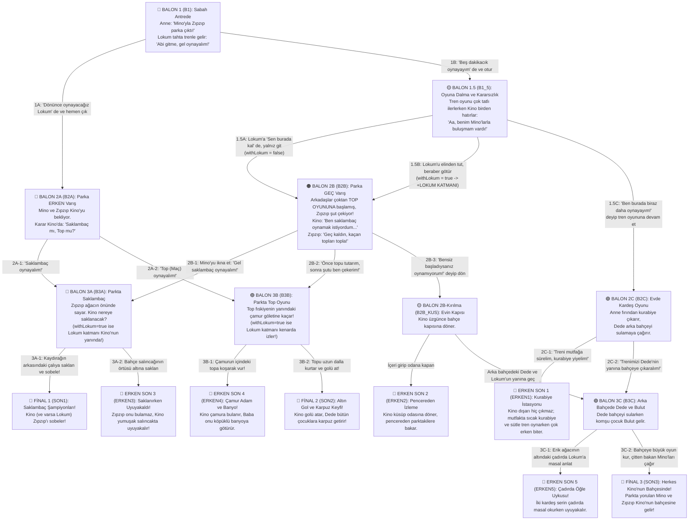

# 🎬 ASTRA İÇİN DOĞRUDAN ÜRETİM VE ANİMASYON REHBERİ: "KİNO’NUN BİR GÜNÜ"
*(Detroit: Become Human Tarzı Dallanan & Birleşen İnteraktif Çizgi Film)*

> **🚨 ASTRA’YA ÖNEMLİ NOT (KULLANICI KARARI):**
> - **"Kino’nun Okulda İlk Günü" (`servise bin / eve geri dön`) senaryosu İPTAL EDİLMİŞTİR.**
> - Onun yerine aşağıda tüm balonları, sahne tarifleri, diyalogları ve durum değişkenleriyle (`state`) verilen **"Kino’nun Bir Günü"** senaryosu kullanılacaktır.
> - Bu senaryoyu **balon (node) tabanlı interaktif çizgi filme / animasyona (`Oyna.html` + sahne animasyonları)** dönüştür.
> - Görsel üretimde `AGENTS.md`, `ekip/kalite/minkino-gorsel-rehberi/OKU.md` ve `ekip/kalite/minkino-gorsel-rehberi/Katalog.html` kurallarına (temiz 2D, düz renk alanları, ince siyah dış kontür, doğrulanmış YouTube karakter referansları) birebir uyulacaktır.

---

## 🛠️ ASTRA İÇİN 4 KRİTİK YAPIM VE ÇİZİM KURALI

1. **4 Yaş (*Caillou*) Doğallığı — Saat Okuma Yok:**
   - Kino 4–5 yaşındadır; saate bakıp *"Saat 10:35 olmuş"* demez.
   - Buluşma yeri evin hemen önündeki, **Anne’nin mutfak penceresinden görebildiği mahalle parkıdır**.
   - Sabah Anne pencereden bakıp *"Kino! Mino’yla Zıpzıp parka çıktı bile, hadi ayakkabını giy!"* diye seslenir. Dün akşamdan sözleşmişlerdir: Parka çıkınca hangi oyunu oynayacaklarını beraber seçeceklerdir ve Kino sabahtan beri **Saklambaç** oynamak istemektedir.

2. **Balon 1.5 — "Geç Kaldığını Kabullenme" Değil, Oyuna Dalıp Kararsız Kalma:**
   - Kino *"Beş dakikacık oynayayım"* deyip Lokum’la tahta tren oynamaya oturduğunda oyuna dalar. Tren minder tünelinden geçerken dışarıdan çocuk sesleri gelir ve Kino birden hatırlar: **"Aa! Benim Mino’larla buluşmam vardı!"**
   - Burada saate bakmaz, geç kaldığını da bilmez. Çocuğun seçimi gerçekten zor olsun diye 3 seçenek çıkar:
     - **A (`1.5A`):** Lokum’a *"Sen burada kal"* deyip parka **yalnız** gitmek.
     - **B (`1.5B`):** Lokum’u elinden tutup parka **beraber** götürmek.
     - **C (`1.5C`):** *"Tren çok güzel oldu, ben burada biraz daha oynayayım!"* deyip evde kalmak.

3. **🎨 ÇİZER & ANİMASYONCU İÇİN "LOKUM KATMANI (`withLokum` Layer)" KOLAYLIĞI:**
   - Çocuk `1.5B` seçeneğinde **"Lokum’u elinden tutup parka götür"** derse, bundan sonraki tüm park sahnelerinde (`B2B`, `B3A`, `B3B`, `SON1`, `SON2`) **arka plan, kamera açısı ve diğer karakterlerin (Kino, Mino, Zıpzıp) çizimi/animasyonu `1.5A` (Yalnız) yoluyla BİREBİR AYNIDIR!**
   - **Bütün sahneyi baştan çizmeye gerek yoktur!** Hazır park sahnesinde Kino’nun yanına sadece ayrı bir katman (layer/sprite) olarak **Lokum** eklenir (`if (state.withLokum) showLokumLayer()`). Böylece çizer/animasyoncu sadece Lokum’u sahneye yerleştirerek iki ayrı hikâye dalını çok pratik ve temiz şekilde çözer.

4. **Her Çocuğun Bildiği Oyunlar (Saklambaç vs. Top Oyunu):**
   - Koli kalesi / karton kızak gibi karmaşık oyunlar YOK. İki temel oyun var: **Saklambaç** ve **Top Oyunu (Maç / Kalecilik)**.
   - **Erken varırsa (`B2A`):** Mino ve Zıpzıp henüz başlamamıştır, Kino’ya sorarlar: *"Saklambaç mı oynayalım, Top mu?"*
   - **Geç varırsa (`B2B`):** Arkadaşları onu beklememiş, çoktan **Top Oyununu** seçip maça başlamıştır! Zıpzıp üstünlüğü almış, şut çekmektedir. Kino *"Ben saklambaç oynamak istiyordum..."* diye üzülür; Zıpzıp ise *"Sen geciktin, kaçan topları topla!"* der.

---

## 🗺️ BALON AKIŞ ŞEMASI (STATE GRAPH)

---

## 📋 ASTRA İÇİN SAHNE SAHNE ANİMASYON, ÇİZİM VE DİYALOG DETAYLARI

### 🔵 BALON 1 (`id: "B1"`): SABAH ANTREDE — "Parktaki Buluşma mı, Lokum’la Tren mi?"
- **Mekân & Kadraj:** Evin aydınlık antresi / oda kapısı. Arka planda Anne mutfak penceresinden dışarı (evin hemen önündeki parka) bakmaktadır. Kino spor ayakkabısını giymiş, kapıya yönelmiştir. Lokum kucağında tahta tren rayları ve kırmızı lokomotifle gelir.
- **Animasyon / Oyunculuk:**
  1. Anne pencereden gülümseyerek Kino’ya seslenir.
  2. Kino sevinçle kapıya dönerken Lokum paytak adımlarla gelip rayları halıya bırakır ve lokomotifi iki patisiyle Kino’ya uzatır.
- **Seslendirme Replikleri:**
  - **Anne:** `"Kino! Bak pencereden gördüm, Mino’yla Zıpzıp parka çıktı bile! Hadi çık, ben de pencereden sana bakıyorum."`
  - **Kino:** `"Yaşasın! Gidip saklambaç oynayalım diyeceğim!"`
  - **Lokum:** `"Abi gitme! Bak çuf çuf getirdim, gel beraber oynayalım! Köprü hep düşüyor..."`
  - **Kino:** `"Ama Lokum, şimdi gitmezsem Mino’yla Zıpzıp bensiz oyuna başlar..."`
- **Seçim Ekranı Sorusu:** `"Kino şimdi ne yapsın?"`
  - **Seçenek 1A (`target: "B2A"`, `withLokum: false`):** `"Söz dönünce oynayacağız" de ve hemen parka çık`
    - *Geçiş Repliği (Kino):* `"Söz Lokum, parktan dönünce en uzun köprüyü yapacağız!"`
  - **Seçenek 1B (`target: "B1_5"`):** `"Beş dakikacık oynayayım" de ve halıya otur`
    - *Geçiş Repliği (Kino):* `"Tamam, gel bakalım, beş dakikacık oynayalım, köprüyü kurup hemen gideceğim."`

---

### 🟡 BALON 1.5 (`id: "B1_5"`): OYUNA DALMA VE KARARSIZLIK ANI
- **Mekân & Kadraj:** Oda/antre halısının üzeri. Kino ve Lokum tahta rayları birleştirmiş, iki koltuk minderinden de "tünel" yapmışlardır.
- **Animasyon / Oyunculuk:**
  1. Kino kırmızı lokomotifi minderin altından *"Çuuuf çuuuf!"* diye geçirir, Lokum ellerini çırparak kıkırdar.
  2. Tam o sırada açık pencereden dışarıdaki çocukların uzak neşeli sesleri duyulur. Kino elindeki lokomotifle bir an durur, gözleri açılır.
  3. Lokum ise yeni bir ray parçasını uzatıp Kino’nun kolunu çekiştirir.
- **Seslendirme Replikleri:**
  - **Lokum:** `"Çuuuf! Abi bak, tren tünele girdi! Bir daha sür!"`
  - **Kino:** `"Aa! Benim Mino’larla parkta buluşmam vardı! Ama tren de çok güzel oldu... Şimdi ne yapsam?"`
- **Seçim Ekranı Sorusu:** `"Kino ne yapsın?"` *(3 Seçenekli Kırılma)*
  - **Seçenek 1.5A (`target: "B2B"`, `withLokum: false`):** `Lokum’a "Sen burada kal" de ve yalnız parka koş`
    - *Geçiş Repliği (Kino):* `"Lokum sen burada oyna, benim Mino’ların yanına gitmem lazım!"`
  - **Seçenek 1.5B (`target: "B2B"`, `withLokum: true`):** `Lokum’u elinden tutup beraber parka götür`
    - *Geçiş Repliği (Kino):* `"Gel Lokum, elimi tut, seni de Mino’ların yanına götüreyim!"`
  - **Seçenek 1.5C (`target: "B2C"`, `withLokum: true`):** `"Ben burada biraz daha oynayayım!" de ve oyuna devam et`
    - *Geçiş Repliği (Kino):* `"Tren çok eğlenceli oldu... Ben burada Lokum’la biraz daha oynayayım!"`

---

### 🔵 BALON 2A (`id: "B2A"`): PARKA ERKEN VARIŞ — "Saklambaç mı, Top mu?"
*(Sadece `1A`’dan erken çıkanların geldiği balon)*
- **Mekân & Kadraj:** Güneşli mahalle parkı. Çınar ağacı, kaydırak ve iki taş. Mino ve Zıpzıp henüz oyuna başlamamış, ortada Kino’yu beklemektedir. Zıpzıp’ın kucağında kırmızı top vardır.
- **Seslendirme Replikleri:**
  - **Mino:** `"Yaşasın, Kino hemen geldi! Şimdi ne oynayacağımızı beraber seçebiliriz! Hadi saklambaç oynayalım!"`
  - **Zıpzıp:** `"Hayır, iki ağacın arasını kale yapıp maç oynayalım! Kino, iyi ki erken geldin, hadi sen seç: Saklambaç mı, top mu?"`
- **Seçim Ekranı Sorusu:** `"Hangi oyunu oynasınlar?"`
  - **Seçenek 2A-1 (`target: "B3A"`):** `"Saklambaç oynayalım!"`
  - **Seçenek 2A-2 (`target: "B3B"`):** `"Top (Maç) oynayalım!"`

---

### 🟠 BALON 2B (`id: "B2B"`): PARKA GEÇ VARIŞ — "Bensiz Başlamışsınız!"
*(`1.5A`’dan Yalnız veya `1.5B`’den `+Lokum Katmanı` ile gelen balon)*
- **🎨 KATMAN KURALI (`withLokum`):**
  - Sahne arka planı ve Mino/Zıpzıp animasyonu tek bir sahnedir.
  - Eğer `state.withLokum === true` ise, Kino’nun hemen sol yanında elini tutan **Lokum katmanı (`lokum-park-layer.png`)** görünür!
- **Mekân & Kadraj:** Parkta Mino iki taşın arasındaki kaleye geçmiş, Zıpzıp ise ortada durup büyük bir keyifle kırmızı topa şut çekmektedir. Çoktan Top Oyununu seçip başlamışlardır. Kino kenardan gelir ve duraksar.
- **Seslendirme Replikleri:**
  - **Kino:** `"Aa... Oyuna başlamışsınız bile! Hani beraber seçecektik? Ben saklambaç oynamak istiyordum..."`
  - **Mino:** `"Seni bekledik Kino ama sen gelmeyince Zıpzıp top oynamaya başladı..."`
  - **Zıpzıp:** *(Topun üstüne ayağını koyar)* `"Evet, geciktin Kino! Şutları ben çekiyorum. İstersen sen çalıların arkasına kaçan topları toplayıp bize at!"`
  - *(Eğer `withLokum === true` ise ek replik)* **Lokum:** `"Abi, niye topu bize vermiyorlar?"`
- **Seçim Ekranı Sorusu:** `"Kino şimdi ne yapsın?"`
  - **Seçenek 2B-1 (`target: "B3A"`):** `Mino’yu ikna et: "Top toplamam! Mino, gel saklambaç oynayalım!"`
    - *Geçiş Repliği (Mino):* `"Doğru söylüyor Zıpzıp, hep sen şut çektin! Şimdi saklambaç oynayacağız, ebe sensin Zıpzıp!"`
  - **Seçenek 2B-2 (`target: "B3B"`):** `Maça katıl: "Önce kaçan topu tutarım, sonra şutu ben çekerim!"`
    - *Geçiş Repliği (Kino):* `"Tamam! Topu öyle bir tutacağım ki sıra bana geçecek!"`
  - **Seçenek 2B-3 (`target: "B2B_KUS"`):** `Üzülüp küsüp dön: "Bensiz başladıysanız ben de oynamıyorum!"`

---

### 🟡 BALON 2B-KIRILMA (`id: "B2B_KUS"`): KÜSKÜN DÖNÜŞ KAPISI
- **Mekân & Kadraj:** Kino’ların evinin bahçe kapısı. Sol tarafta evin ön kapısı, sağ tarafta ise Dede Hasan’ın göründüğü arka bahçe yolu vardır.
- **Seslendirme Replikleri:**
  - **Kino:** `"Bensiz maça başladılar... Hiç eğlenceli değil. Odamıza mı gitsem, yoksa arka bahçeye Dede’nin yanına mı geçsem?"`
- **Seçim Ekranı Sorusu:** `"Kino nereye gitsin?"`
  - **Seçenek A (`target: "ERKEN2"`):** `Doğrudan eve gir ve odana git`
  - **Seçenek B (`target: "B3C"`):** `Üzüntüyü unut, arka bahçeye Dede ve Lokum’un yanına geç`

---

### 🟢 BALON 2C (`id: "B2C"`): EVDE VE BAHÇEDE KARDEŞ OYUNU
*(`1.5C`’de "Ben burada biraz daha oynayayım" diyenlerin yolu)*
- **Mekân & Kadraj:** Koridor ve mutfak kapısı. Kino ve Lokum tren raylarını mutfak kapısına kadar uzatmıştır. Anne elinde sıcak kurabiye tepsisiyle mutfaktan, Dede Hasan ise bahçe şapkasıyla arka kapıdan seslenir.
- **Seslendirme Replikleri:**
  - **Anne:** `"Kino, Lokum! Fırından taze kurabiye çıktı, sütlerinizi de koydum!"`
  - **Dede Hasan:** `"Hava dışarıda çok güzel çocuklar, bahçeyi sulayacağım, gelin treninizi bahçeye çıkarın!"`
  - **Lokum:** `"Abi, kurabiye mi yiyelim, bahçeye mi çıkalım?"`
- **Seçim Ekranı Sorusu:** `"Kino ve Lokum ne yapsın?"`
  - **Seçenek 2C-1 (`target: "ERKEN1"`):** `"İçeride kalalım, trenimiz mutfaktan kurabiye taşısın!"`
  - **Seçenek 2C-2 (`target: "B3C"`):** `"Trenimizi alıp Dede’yle arka bahçeye çıkalım!"`

---

### 🔵 BALON 3A (`id: "B3A"`): PARKTA SAKLAMBAÇ
*(`2A-1` veya `2B-1`’den gelen yol — `withLokum === true` ise **+Lokum Katmanı** Kino’nun yanındadır!)*
- **Mekân & Kadraj:** Park. Zıpzıp büyük çınar ağacına yüzünü dönüp gözlerini kapatmış saymaktadır. Sağ tarafta kaydırağın arkasındaki çalılık (Mino oradan el sallar), sol tarafta ise Kino’ların bahçe çiti yanındaki tenteli, yumuşak minderli salıncak koltuk vardır.
- **Seslendirme Replikleri:**
  - **Zıpzıp:** `"Bir, iki, üç, dört... On olunca geliyorum, sağım solum sobe!"`
  - **Mino:** *(Fısıldayarak)* `"Kino! Çabuk kaydırağın arkasındaki çalıya gel!"`
  - **Kino:** `"Çalıya mı saklansam, yoksa şu örtülü salıncak koltuğun içine mi girsem? Orada kimse beni bulamaz!"`
- **Seçim Ekranı Sorusu:** `"Kino nereye saklansın?"`
  - **Seçenek 3A-1 (`target: "SON1"`):** `Mino’nun yanına, kaydırağın arkasındaki çalıya saklan ve sobele!`
  - **Seçenek 3A-2 (`target: "ERKEN3"`):** `Kimse bulamasın diye salıncak koltuğun örtüsü altına saklan!`

---

### 🟣 BALON 3B (`id: "B3B"`): PARKTA TOP VE ÇAMUR GÖLETİ
*(`2A-2` veya `2B-2`’den gelen yol — `withLokum === true` ise **+Lokum Katmanı** çimenlerin kenarında izler!)*
- **Mekân & Kadraj:** Parkta fıskiyenin yanındaki çukurda büyük bir çamur göleti oluşmuştur ve kırmızı top tam çamurun ortasında durmaktadır!
- **Seslendirme Replikleri:**
  - **Zıpzıp:** `"Eyvah! Top çamur göletinin ortasına kaçtı! Şimdi kim çıkaracak onu?"`
  - **Kino:** `"Koşup doğrudan çamurun içindeki topa mı vursam, yoksa yerdeki uzun dalla topu çekip kurtarsam mı?"`
- **Seçim Ekranı Sorusu:** `"Kino topu nasıl alsın?"`
  - **Seçenek 3B-1 (`target: "ERKEN4"`):** `Hiç beklemeden koşup çamurun içindeki topa vur!`
  - **Seçenek 3B-2 (`target: "SON2"`):** `Yerdeki uzun dal parçasıyla topu çamurdan çekip kurtar!`

---

### 🟢 BALON 3C (`id: "B3C"`): ARKA BAHÇEDE DEDE VE KOMŞU BULUT
*(`2C-2` veya `B2B_KUS`’tan gelen yol)*
- **Mekân & Kadraj:** Kino’ların arka bahçesi. Dede Hasan erik ağacının altına renkli bir örtüyle gölge çadırı kurmuştur. Yan bahçeden komşu çocuk **Bulut** (kayısı tonunda) oyuncaklarıyla gelmiştir.
- **Seslendirme Replikleri:**
  - **Bulut:** `"Kino, çadırınız çok güzel olmuş! Gel önüne tren yolunu ve su taslarını dizelim!"`
  - **Lokum:** *(Minderin üstünde esneyerek)* `"Abi, çadırın içinde bana resimli kitaptan masal okur musun?"`
- **Seçim Ekranı Sorusu:** `"Bahçede ne yapsınlar?"`
  - **Seçenek 3C-1 (`target: "ERKEN5"`):** `Çadırın içine girip Lokum’a masal anlat`
  - **Seçenek 3C-2 (`target: "SON3"`):** `Bahçeye büyük tren ve su oyunu kur; parktan dönen Mino’ları da çağır!`

---

## 🛑 5 ERKEN SON (EARLY ENDINGS) VE 🏁 3 ANA FİNAL SAHNESİ

| Balon ID | Başlık | Tür | Sahne & Animasyon Özeti | Kapanış Repliği |
| :--- | :--- | :--- | :--- | :--- |
| **`ERKEN1`** | **Kurabiye İstasyonu** | 🛑 Çok Erken Son | Kino dışarı hiç çıkmaz. Mutfak halısında tahta trenin vagonlarına Anne’nin kurabiyelerini koyup Lokum’la süt içerler. | **Kino:** `"Dışarı çıkmadık ama kurabiye trenimiz çok lezzetli oldu!"` *(Son — Başa/Balona Dön)* |
| **`ERKEN2`** | **Pencereden İzleme** | 🛑 Erken Son | Kino küsüp odasına dönmüştür. Pencereden dışarıda oynayan Mino ve Zıpzıp’a bakar, iç çeker. | **Kino:** `"Keşke küsüp gelmeseydim ya da sabah hemen çıksaydım..."` *(Son — Başa/Balona Dön)* |
| **`ERKEN3`** | **Saklanırken Uyuyakaldı!** | 🛑 Orta Erken Son | Kino salıncak koltuğun örtüsü altında saklanırken Zıpzıp uzakta onu arar; Kino ise yumuşak minderde sallana sallana uyuyakalır! | **Zıpzıp (uzaktan):** `"Kino neredesin? Çık ortaya!"` **Kino:** `"Mışıl mışıl..."` *(Son — Başa/Balona Dön)* |
| **`ERKEN4`** | **Çamur Adam ve Köpüklü Banyo!** | 🛑 Orta Erken Son | Kino çamurdaki topa vurunca *ŞLAAAP!* diye burnuna kadar çamur olur. Herkes güler, Baba onu kucaklayıp sıcak köpüklü banyoya sokar. | **Baba:** `"Seni gidi çamur şampiyonu, doğru köpüklü banyoya!"` *(Son — Başa/Balona Dön)* |
| **`ERKEN5`** | **Çadırda Tatlı Öğle Uykusu** | 🛑 Orta Erken Son | Erik ağacının altındaki serin çadırda Kino Lokum’a masal anlatırken ikisi de minderlerin üzerinde uyuyakalır; Anne üstlerini örter. | **Anne (fısıltıyla):** `"Tatlı rüyalar benim küçük kampçılarım..."` *(Son — Başa/Balona Dön)* |
| **`SON1`** | **Saklambaç Şampiyonları!** | 🏁 Ana Final 1 | Kino *(ve `withLokum` açıksa minik adımlarla koşan Lokum!)* çalıdan fırlayıp ağaca koşar ve **"SOBE!"** yapar! Hep birlikte kahkahalarla saklambaç oynarlar. | **Kino:** `"Sobe! En güzel saklambaç günü oldu!"` |
| **`SON2`** | **Günün Altın Golü ve Karpuz Keyfi!** | 🏁 Ana Final 2 | Kino dalla kurtardığı topla harika bir şut çekip golü atar! Dede Hasan bahçe kapısından soğuk karpuz dilimleriyle çıkar, bütün çocuklar karpuz yer. | **Dede Hasan:** `"Bu güzel gole soğuk karpuz gider! Afiyet olsun şampiyonlar!"` |
| **`SON3`** | **Herkes Kino’nun Bahçesinde!** | 🏁 Ana Final 3 | Parkta sıcaktan yorulan Mino ve Zıpzıp çitten Kino, Lokum ve Bulut’un bahçe çadırını görüp hayran kalır. Kino kapıyı açar, bütün çocuklar bahçede buluşur! | **Mino:** `"Kino, sizin bahçe parktan bile güzel olmuş! İyi ki bizi de çağırdın!"` |
