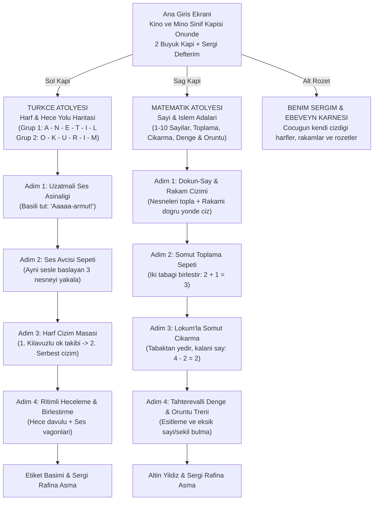

# 🎓 MİNKİNO — OKUL ÖNCESİ TÜRKÇE & MATEMATİK OYUNU (TAM PLANLAMA DOSYASI)

> **Bu Dokümanın Amacı:** 4–6 yaş (okul öncesi / 1. sınıfa hazırlık) çocukları için **Türkçe (Ses, Harf Çizimi, Heceleme)** ve **Matematik (Sayı, Rakam Çizimi, Somut Toplama-Çıkarma, Mantık)** öğreten oyunun tüm ekran akışını, içerik tablolarını, etkileşim kurallarını ve sahne tasarımlarını eksiksiz olarak tanımlamaktır.

---

## 1. TEMEL TASARIM VE PEDAGOJİ KURALLARI

1. **Harf Adı Değil, Harf Sesi Öğretilir (MEB ANETİL Sistemi):**
   - Oyunun hiçbir yerinde *"Be harfi, Ce harfi, Me harfi, Le harfi"* **denmez**.
   - Harfler yalnızca kelimenin başındaki **saf sesi uzatılarak** söylenir:
     - `A` → **`"Aaaaa... Armut! Aaa-armut!"`**
     - `N` → **`"Nnnnn... Nar! Nnn-nar!"`**
     - `E` → **`"Eeeee... Elma! Eee-elma!"`**
     - `T` → **`"Ttttt... Top! Ttt-top!"`**
     - `İ` → **`"İiiii... İnek! İii-inek!"`**
     - `L` → **`"Lllll... Limon! Lll-limon!"`**
     - `M` → **`"Mmmmm... Marakas! Mmm-marakas!"`**
2. **Test / Çalışma Yaprağı Havası Yok — %100 Oyuncak Fiziği:**
   - Hiçbir ekranda kırmızı çarpı (`X`), *"Yanlış yaptın"* sesi, süre sayacı veya sıkıcı şıklı test bulunmaz.
   - Yanlış nesne seçildiğinde nesne kendi sesini çıkarır, komik bir fiziksel tepkiyle (yaylanarak, zıplayarak) yerine döner ve kelimenin kendi başlangıç sesi vurgulanarak fark ettirilir (*"Bu Ttt-top! Biz Aaa arıyoruz"*).
3. **Minkino Görsel ve Karakter Kuralları:**
   - **Çizim Dili:** Tertemiz, düz ve dokusuz renk alanlarına sahip 2D vektörel görünüm; tüm karakterlerde, meyvelerde, harf kartlarında ve arka planlarda **ince siyah dış kontür** kullanılır. Yapay doku veya bulanık gradyan kullanılmaz.
   - **Karakter Kadrosu:**
     - **Kino:** 4–5 yaşında, oyuncuyla birlikte öğrenen ana karakter.
     - **Mino:** Yardımsever kedi arkadaş (ipucu ve ritim arkadaşı).
     - **Lokum:** 2 yaşında, beyaz tüylü küçük kardeş (kurabiye/meyve paylaşımı ve çıkarma oyunlarında yer alır).
     - **Zıpzıp:** Hızlı konuşan, enerjik erkek tilki (hece vagonları ve yarışmalı/hareketli sahnelerde yer alır).
     - **Bulut:** Kayısı tonunda, lila üstlü ve turkuaz şortlu arkadaş.
     - **Ceren Öğretmen:** Sıcak ve teşvik edici rehber öğretmen.

---

## 2. OYUNUN GENEL EKRAN AKIŞI (UX MİMARİSİ)

---

## 3. BÖLÜM 1: TÜRKÇE ATÖLYESİ — DETAYLI SAHNE VE İÇERİK PLANI

### 3.1. Harf, Ses, Nesne ve Çizim Vuruş Tablosu (1. ve 2. Grup)

Her harf durağında kullanılacak tam veri seti:

| Harf | Uzatmalı Seslendirme | 3 Anahtar Nesne (Doğru) | Şaşırtmaca Nesneler (Yanlış) | Doğru Çizim Vuruş Yönü (Ok Sırası) |
| :--- | :--- | :--- | :--- | :--- |
| **`A`** | `"Aaaaa... Armut! Aaa-armut!"` | **Armut, Arı, Araba** | Elma (`E`), Top (`T`), Balık (`B`) | **1)** Tepeden sol alta eğik çizgi **2)** Tepeden sağ alta eğik çizgi **3)** Soldan sağa orta yatay köprü |
| **`N`** | `"Nnnnn... Nar! Nnn-nar!"` | **Nar, Nane, Nota** | Limon (`L`), Armut (`A`), Kedi (`K`) | **1)** Yukarıdan aşağı sol dikey **2)** Sol üstten sağ alta çapraz **3)** Yukarıdan aşağı sağ dikey |
| **`E`** | `"Eeeee... Elma! Eee-elma!"` | **Elma, Erik, Ekmek** | Armut (`A`), Muz (`M`), Nar (`N`) | **1)** Yukarıdan aşağı dikey gövde **2)** Soldan sağa üst çizgi **3)** Soldan sağa orta çizgi **4)** Soldan sağa alt çizgi |
| **`T`** | `"Ttttt... Top! Ttt-top!"` | **Top, Tren, Tavşan** | Elma (`E`), Araba (`A`), Kalem (`K`) | **1)** Soldan sağa üst çatı çizgisi **2)** Ortadan aşağı dikey gövde |
| **`İ`** | `"İiiii... İnek! İii-inek!"` | **İnek, İncir, İp** | Elma (`E`), Top (`T`), Limon (`L`) | **1)** Yukarıdan aşağı dikey çizgi **2)** Üstteki nokta dokunuşu |
| **`L`** | `"Lllll... Limon! Lll-limon!"` | **Limon, Lale, Leylek** | Nar (`N`), Elma (`E`), Marakas (`M`) | **1)** Yukarıdan aşağı dikey gövde **2)** Soldan sağa alt taban çizgisi |
| **`O`** | `"Ooooo... Otobüs! Ooo-otobüs!"` | **Otobüs, Orman, Oyuncak** | Araba (`A`), Tren (`T`), Elma (`E`) | **1)** Üst noktadan başlayıp sola-aşağı-sağa-yukarı tek kesintisiz çember |
| **`K`** | `"Kkkkk... Kedi! Kkk-kedi!"` | **Kedi, Kalem, Kurabiye** | Top (`T`), Köpek değil Balık (`B`), Limon (`L`) | **1)** Yukarıdan aşağı dikey gövde **2)** Sağ üstten ortaya eğik kol **3)** Ortadan sağ alta eğik ayak |
| **`U`** | `"Uuuuu... Uçak! Uuu-uçak!"` | **Uçak, Uçurtma, Un** | Otobüs (`O`), Arı (`A`), İp (`İ`) | **1)** Sol üstten aşağı inip alttan kıvrılarak sağ üste çıkan çanak |
| **`R`** | `"Rrrrr... Roket! Rrr-roket!"` | **Roket, Radyo, Resim** | Uçak (`U`), Top (`T`), Lale (`L`) | **1)** Yukarıdan aşağı dikey gövde **2)** Üstten ortaya yarım yuvarlak karın **3)** Ortadan sağ alta eğik ayak |
| **`I`** | `"Iıııı... Irmak! Iıı-ırmak!"` | **Irmak, Ispanak, Işık** | İnek (`İ`), Elma (`E`), Nar (`N`) | **1)** Yukarıdan aşağı tek düz dikey çizgi |
| **`M`** | `"Mmmmm... Marakas! Mmm-marakas!"` | **Marakas, Muz, Mantar** | Davul (`D`), Limon (`L`), Armut (`A`) | **1)** Yukarıdan aşağı sol dikey **2)** Sol üstten ortaya eğik **3)** Ortadan sağ üste eğik **4)** Sağ üstten aşağı dikey |

---

### 3.2. Türkçe Durağının 4 Sahnelik Detaylı Oynanışı

#### Sahne 1: Uzatmalı Ses Aşinalığı ("Basılı Tut, Sesi Uzat!")
- **Ekran Düzeni:** Ortada seçilen harfin ana nesnesi (ör. kocaman, parlak bir **Armut**), sol altta **Kino**, sağ üstte ise harfin silueti (`A`).
- **Etkileşim:**
  1. Ceren Öğretmen seslenir: `"Bak, bu bir Aaa-armut! Armuta parmağını basılı tut, sesini beraber uzatalım!"`
  2. Çocuk Armut’a parmağını **basılı tuttuğu sürece**:
     - `"Aaaaa..."` sesi kesintisiz döner.
     - Armut büyür, neşeyle titrer ve etrafında renkli ses halkaları ile küçük `A` harfleri uçar.
     - Kino da ağzını kocaman açıp `"Aaaaa..."` pozuyla eşlik eder.
  3. Çocuk parmağını çektiği anda:
     - `"...rmut! Aaa-armut!"` sesi tamamlanır.
     - Alt kısımda **`A` - `r` - `m` - `u` - `t`** yazısı belirir; baştaki **`A`** harfi altın sarısı parlayıp zıplar!
  4. Hemen ardından yanına diğer 2 kardeş nesne (**Arı** ve **Araba**) gelir; çocuk onlara da dokunarak `"Aaa-arı!"` ve `"Aaa-araba!"` seslerini duyar.

#### Sahne 2: Ses Avcısı ("Acıkan Ses Çantası")
- **Ekran Düzeni:** Ekranın ortasında ağzı fermuarlı, üzerinde büyük **`A`** harfi bulunan sevimli bir **Okul Çantası (veya Mino’nun Sepeti)** durur. Alt tezgâhta 4 nesne dizilidir (3 doğru: *Armut, Arı, Araba*; 1 veya 2 şaşırtmaca: *Top, Balık*).
- **Etkileşim:**
  - Her nesnenin altında küçük bir **Dinle (Hoparlör)** düğmesi vardır; çocuk isterse önce dinler (`"Aaa-arı"` vs `"Ttt-top"`).
  - Çocuk doğru nesneyi çantanın ağzına sürüklediğinde:
    - Çanta ağzını kocaman açıp *"Ham! Aaa-arı!"* diye yutar ve karnındaki yıldız sayacı `1/3 → 2/3 → 3/3` ilerler.
  - Çocuk yanlış nesneyi (ör. *Top*) sürüklediğinde:
    - Çanta ağzını büzüp *"Püü! Bu Ttt-top! Başında Ttt sesi var!"* der; top *Boing!* sesiyle tezgâha geri seker.

#### Sahne 3: Harf Çizim Masası ("Kılavuzlu İz → Serbest Çizim")
- **Aşama 3A (Kılavuzlu Ok Yolu):**
  - Defter sayfasında harfin ilk vuruş yolu kesik çizgilerle, başlangıç noktası ise parlayan yeşil bir **Arı / Yıldız** ile gösterilir.
  - Önce Ceren Öğretmen tebeşir animasyonuyla vuruşun nasıl çizileceğini 1 saniyede gösterir (`"Yukarıdan aşağıya!"`, `"Şimdi ortadaki köprüyü bağla!"`).
  - Çocuk parmağıyla başlangıç noktasından bitişe çizerken iz renkli boyaya dönüşür ve çizim boyunca harf sesi (`"Aaaaa..."`) duyulur.
- **Aşama 3B (Serbest Defter Çizimi):**
  - Kılavuz çizgiler kaybolur, sadece sol üstte küçük örnek harf kalır.
  - `"Şimdi kendi A harfini sen çiz!"`
  - Çocuk Mercan, Turkuaz veya Mor boya kalemini seçip boş kâğıda kendi harfini yazar.
  - Çizim tamamlandığında çocuğun kendi el yazısı harfi çerçevelenip **Sergi Etiketi**ne dönüşür!

#### Sahne 4: Ritimli Heceleme ve Hece Treni
- **Oyun 4A — Hece Davulu (Kelimeyi Hecelerine Ayırma):**
  - Ekranda bir nesne kartı (tablodaki hece kelimeleri) ve altında hece sayısı kadar **Davul (veya Nilüfer Yaprağı)** çıkar.
  - Çocuk davullara soldan sağa sırayla vurur:

| Kelime | Hece Sayısı | 1. Vuruş | 2. Vuruş | 3. Vuruş | Birleşme Anı |
| :--- | :---: | :--- | :--- | :--- | :--- |
| **Elma** | 2 | `"El"` | `"ma"` | — | `"El - ma! Elma!"` (Elma ikiye bölünüp birleşir) |
| **Armut** | 2 | `"Ar"` | `"mut"` | — | `"Ar - mut! Armut!"` |
| **Limon** | 2 | `"Li"` | `"mon"` | — | `"Li - mon! Limon!"` |
| **Araba** | 3 | `"A"` | `"ra"` | `"ba"` | `"A - ra - ba! Araba!"` (Araba kornayla geçer) |
| **Marakas** | 3 | `"Ma"` | `"ra"` | `"kas"` | `"Ma - ra - kas! Marakas!"` (Marakas şıkırdar) |
| **Kelebek** | 3 | `"Ke"` | `"le"` | `"bek"` | `"Ke - le - bek! Kelebek!"` (Kelebek kanat çırpar) |
| **Otobüs** | 3 | `"O"` | `"to"` | `"büs"` | `"O - to - büs! Otobüs!"` |

- **Oyun 4B — Ses Vagonlarını Çarpıştır (İlk Okuma / Hece Birleştirme):**
  - Rayın sol ucunda sesli harf vagonu, sağ ucunda sessiz harf vagonu durur.
  - Çocuk iki vagonu parmağıyla ortaya doğru sürükler; vagonlar yaklaşırken sesler uzar ve birleşince anlamlı kelime/hece resmi çıkar:
    - **`E` (`"Eee..."`) + `L` (`"lll..."`) → `"EL!"`** *(Ekranda sallanan bir El belirir!)*
    - **`A` (`"Aaa..."`) + `L` (`"lll..."`) → `"AL!"`** *(Kino kırmızı elmayı alır!)*
    - **`A` (`"Aaa..."`) + `T` (`"ttt..."`) → `"AT!"`** *(Sevimli bir At kişneyerek zıplar!)*
    - **`İ` (`"İii..."`) + `P` (`"ppp..."`) → `"İP!"`** *(Renkli atlama ipi çıkar!)*
    - **`U` (`"Uuu..."`) + `N` (`"nnn..."`) → `"UN!"`** *(Un çuvalı ve kurabiye çıkar!)*
    - **`O` (`"Ooo..."`) + `K` (`"kkk..."`) → `"OK!"`** *(Hedefe giden oyuncak ok çıkar!)*

---

## 4. BÖLÜM 2: MATEMATİK ATÖLYESİ — DETAYLI SAHNE VE İÇERİK PLANI

### 4.1. Sayı ve Rakam Çizim Tablosu (`1–10`)

| Rakam | Nesne Seti | Doğru Çizim Vuruş Yönü |
| :---: | :--- | :--- |
| **`1`** | 1 Güneş / 1 Armut | Sol ortadan tepeye kısa eğik çıkış, tepeden aşağı düz dikey iniş |
| **`2`** | 2 Elma / 2 Kuş | Sol üstten sağa kıvrılan baş, sol alta eğik iniş, soldan sağa düz taban |
| **`3`** | 3 Marakas / 3 Çilek | Üst yarım daire kıvrımı + alt yarım daire kıvrımı (tek akışta) |
| **`4`** | 4 Kalem / 4 Tekerlek | **1)** Yukarıdan sola-aşağı ve sağa yatay **2)** Yukarıdan aşağı kesen dikey çizgi |
| **`5`** | 5 Denizyıldızı | **1)** Boyundan aşağı ve yuvarlak karın **2)** Soldan sağa üst şapka çizgisi |
| **`6`** | 6 Çiçek | Sağ üstten sola-aşağı inip altta yuvarlak halka olarak kapanan tek çizgi |
| **`7`** | 7 Yaprak | **1)** Soldan sağa üst düz çizgi ve sol alta eğik iniş **2)** Ortada kısa yatay kuşak |
| **`8`** | 8 Balık | Üstten S harfi gibi inip alttan yukarı çapraz kapanan kesintisiz halka |
| **`9`** | 9 Balon | Üstte yuvarlak baş, sağdan aşağı düz/hafif kıvrık kuyruk |
| **`10`** | 10 Yıldız | `1` ve `0` rakamlarının yan yana çizimi |

---

### 4.2. Matematik Durağının 4 Sahnelik Detaylı Oynanışı

#### Sahne 1: Dokun-Say ve Rakamı Çiz
1. **Birebir Sayma:** Ekranda örneğin ağaçta `4` elma vardır. Çocuk her elmaya dokunduğunda elma sepete düşer, üzerinde `1, 2, 3, 4` sayısı yanar ve sesli sayılır.
2. **Miktar Eşleştirme (Tepsi Seçimi):** Masada iki tepsi vardır (birinde `2`, diğerinde `4` nesne). `"Hangi tepside 4 elma var?"` Az veya fazla olana dokunursa nesneler tek tek sayılıp neden az/fazla olduğu gösterilir.
3. **Rakam Çizimi:** Kılavuzlu oklarla rakam çizilir, ardından serbest defter sayfasına çocuğun kendi rakamı yazdırılır ve meyve rafına etiket olarak asılır (`4 Elma`).

#### Sahne 2: Somut Toplama ("Sepette Birleştir: `+`")
- **Ekran Düzeni:** Sol üstte **Mino’nun Tabağı** (`2 Çilek`), sağ üstte **Kino’nun Tabağı** (`1 Çilek`), ortada büyük **Paylaşım Sepeti**, en altta ise büyük görsel işlem şeridi: `[ 2 ] + [ 1 ] = [ ? ]`.
- **Etkileşim:**
  1. Çocuk Mino’nun tabağındaki çilekleri sepete sürükler (`"Bir, iki!"`).
  2. Ardından Kino’nun tabağındaki çileği sepete sürükler (`"Üç! İki çilek, bir çilek daha, üç çilek etti!"`).
  3. Alttaki `[ ? ]` kutusuna doğru rakamı (`3`) sürükler veya çizer!
- **Kademeli Seviyeler:** `1+1=2`, `2+1=3`, `2+2=4`, `3+2=5`, `4+2=6`, `5+3=8`.

#### Sahne 3: Somut Çıkarma ("Lokum Kaç Tanesini Yedi?: `-`")
- **Ekran Düzeni:** Ortadaki tabakta `4 Kurabiye`, sağda acıkmış bekleyen **Lokum** (üzerindeki konuşma balonunda `2 Kurabiye` resmi vardır). Altta işlem şeridi: `[ 4 ] - [ 2 ] = [ ? ]`.
- **Etkileşim:**
  1. `"Tabakta 4 kurabiye var. Lokum 2 tanesini yemek istiyor. Hadi Lokum'a 2 kurabiye verelim!"`
  2. Çocuk 2 kurabiyeyi sürükleyip Lokum’a verir; Lokum *"Ham! Ham!"* diye yer ve tabaktan 2 kurabiye eksilir.
  3. `"4 kurabiyeden 2 tanesi gitti. Tabakta kaç kurabiye kaldı? Dokun ve say!"`
  4. Çocuk kalan kurabiyelere dokunur (`"Bir, iki!"`) ve sonuca `2` rakamını yerleştirir!
- **Kademeli Seviyeler:** `2-1=1`, `3-1=2`, `4-2=2`, `5-2=3`, `5-3=2`, `6-2=4`.

#### Sahne 4: Tahterevalli Terazisi (Denge `=`) ve Örüntü Treni
- **Oyun 4A — Tahterevalli Denge Oyunu (`Az - Çok - Eşit`):**
  - Bahçedeki tahterevallinin sol koltuğunda `3` karpuz (veya sayı ağırlığı), sağ koltuğunda ise `1` karpuz ve havada asılı kalan Kino vardır!
  - Çocuk alttaki sepetten sağ koltuğa `1` karpuz koyar (`Toplam 2` → tahterevalli biraz iner ama hâlâ eğiktir).
  - `1` karpuz daha koyduğunda (`Toplam 3 = 3`) tahterevalli **"Tık!"** diye tam yatay dengeye gelir, ortada **`3 = 3`** işareti parlar ve Kino sevinçle el sallar!
  - Fazla koyarsa (`4`) bu sefer sol taraf havaya fırlar (*çocuk deneme-yanılmayla eşitliği keşfeder*).
- **Oyun 4B — Örüntü ve Şekil Treni:**
  - Tren vagonlarında eksik kuralı tamamlama:
    - *Renk/Nesne Örüntüsü:* `🍎 - 🍐 - 🍎 - 🍐 - [ ? ]`
    - *Şekil Örüntüsü:* `🔺 - 🟦 - 🔺 - 🟦 - [ ? ]`
    - *Sayı Dizisi:* `1 - 2 - [ ? ] - 4 - 5`

---

## 5. SERGİ DEFTERİ & EBEVEYN GELİŞİM EKRANI

Çocuk her harf ve sayı durağını bitirdiğinde **Sergi Dolabı**ndaki raflar kendi el yazısıyla yaptığı etiketlerle dolar:
- Örneğin 1. rafta çocuğun kendi çizdiği **`1`** rakamı, yanında **Armut** resmi ve kendi çizdiği **`A`** harfi yan yana durur!
- Rafa dokunulduğunda Kino etiketi okur: **`"Bir Aaa-armut!"`**, **`"İki Eee-elma!"`**, **`"Üç Mmm-marakas!"`**.
- **Ebeveyn Karnesi** sekmesinde ise anne-baba; çocuğun hangi harflerin sesini tanıdığını, hangi harfleri/rakamları doğru yönde çizebildiğini ve toplama-çıkarma ilerlemesini tek bakışta görür.

---

## 6. REKLAM VE PAZARLAMA VİDEO METİNLERİ

1. **Ana Reklam ("1. Sınıfta Geri Kalmasın"):**
   - *"Çocuğunuz okula başlarken arkadaşlarının gerisinde kalmasın! Harfleri 'Be, Ce, Me' diye yanlış ezberletmek yerine, okulda öğretildiği gibi gerçek sesiyle (**'Aaa-armut!'**, **'Eee-elma!'**) kulağını alıştırın. Parmağıyla doğru yönde harf ve rakam çizsin, kelimeleri hecelesin, toplama ve çıkarmayı görerek öğrensin. Günde 10 dakikayla 1. sınıfa özgüvenle başlasın!"*
2. **Bilgilendirici Viral Reklam ("Be-Ce Hatası"):**
   - *"Çocuğunuza okul öncesi harfleri sakın 'Be, Ce, Me' diye öğretmeyin! 1. sınıfa geçtiğinde 'M-A' kelimesini 'Me-A' diye okumaya çalışır ve birleştiremez. Doğrusu harfin saf sesini uzatmaktır: **'Mmm-marakas!'**, **'Aaa-armut!'**... Minkino tam olarak MEB’in yeni ses sistemiyle çocuğunuzu okumaya ve matematiğe oyunla hazırlar."*
